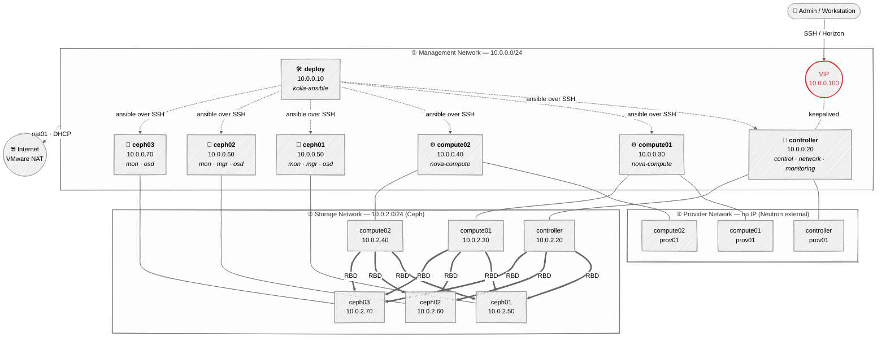

# openstack-homelab

OpenStack homelab deployed with **[Kolla-Ansible](https://docs.openstack.org/kolla-ansible/latest/)**
on 7 VMs, with a 3-node **Ceph** cluster as the storage backend. This repo holds all configuration
and docs; it is the source of truth for the lab.

## Architecture



## Hosts

| Host       | Role                              | Management (①) | Storage (③) |
|------------|-----------------------------------|----------------|-------------|
| deploy     | Kolla-Ansible deployment node     | 10.0.0.10      | —           |
| controller | Control plane, Neutron, monitoring | 10.0.0.20      | 10.0.2.20   |
| compute01  | Nova compute (hypervisor)         | 10.0.0.30      | 10.0.2.30   |
| compute02  | Nova compute (hypervisor)         | 10.0.0.40      | 10.0.2.40   |
| ceph01     | Ceph node (Glance/Cinder/Nova)    | 10.0.0.50      | 10.0.2.50   |
| ceph02     | Ceph node (clone of ceph01)       | 10.0.0.60      | 10.0.2.60   |
| ceph03     | Ceph node (clone of ceph01)       | 10.0.0.70      | 10.0.2.70   |
| **VIP**    | `kolla_internal_vip_address`      | **10.0.0.100** | —           |

## Networks

| # | Name       | CIDR          | Purpose                                                     |
|---|------------|---------------|-------------------------------------------------------------|
| —  | NAT        | DHCP (VMware) | Internet access, default route + DNS (`nat01`)              |
| ① | Management | 10.0.0.0/24   | SSH, Ansible, OpenStack APIs, internal VIP (`network_interface`, `mgmt01`) |
| ② | Provider   | no IP         | Neutron external network (`neutron_external_interface`, `prov01`) on controller/computes |
| ③ | Storage    | 10.0.2.0/24   | Ceph client/public traffic (`storage_interface`, `stor01`)    |

## Repository layout

```
.
├── ansible.cfg          # points at inventory/hosts.yml
├── ceph/                # Ceph cluster runbook (cephadm bootstrap → pools/users)
├── inventory/
│   ├── hosts.yml        # all VMs by name, grouped by role (mgmt_ip / storage_ip)
│   ├── group_vars/      # shared vars (networks, interfaces, VIP)
│   └── host_vars/       # per-host overrides
├── netplan/             # per-VM netplan — source of truth for host networking
└── playbooks/
    ├── preconfig.yml    # node prep: hosts, NIC names, time sync (tags below)
    ├── ceph-prereqs.yml # Ceph nodes: upgrade, Docker, cephadm (no cluster yet)
    ├── ceph-ssh.yml     # root SSH key from ceph01 to all Ceph nodes (cephadm)
    └── roles/           # clone_identity, etc_hosts, ssh_client, netif_rename,
                         # chrony, ceph_prereqs
```

## Syncing the repo to the deploy VM

Edit and commit on the workstation; `~/openstack-homelab` on the deploy VM is a
git repo that **receives pushes** (`receive.denyCurrentBranch=updateInstead`),
so its files update the moment you push. `origin` has two push URLs, so one
command updates GitHub and the deploy VM:

```bash
git push            # GitHub + deploy VM
git push deploy     # deploy VM only
```

One-time setup on a new workstation clone:

```bash
git remote add deploy opadm@10.0.0.10:openstack-homelab
git config --add remote.origin.pushurl git@github.com:MarouaneBouaricha/openstack-homelab.git
git config --add remote.origin.pushurl opadm@10.0.0.10:openstack-homelab
```

Don't edit tracked files on the deploy VM (Kolla's `all-in-one` and
`inventory/multinode` included): the push is refused while its working tree
has changes (`git -C ~/openstack-homelab status` shows them). Commit on the
workstation and push instead. A new file created only on the VM blocks the push
once the same path is committed here; move it aside on the VM first.

## Quick start

On the deploy VM (`opadm@10.0.0.10`), Ansible lives in a virtualenv:

```bash
source ~/venv/bin/activate
cd ~/openstack-homelab
ansible-playbook playbooks/preconfig.yml -K   # node prep (idempotent)
ansible all -m ping
```

`preconfig.yml` runs in three tagged parts (`--tags hosts|netif|ntp`):

| Tag     | What it does |
|---------|--------------|
| `hosts` | On cloned VMs, regenerates `/etc/machine-id` and the SSH host keys (only on a host whose machine-id matches an earlier host's; also `--tags clone`). Sets hostnames and writes every node into `/etc/hosts` (`10.0.0.10 deployment deploy`, `10.0.0.20 controller`, …); drops the `127.0.1.1` line. On the deploy VM, trusts host keys by name and adds `~/.ssh/config`, so `ssh controller` works. |
| `netif` | Renames NICs by MAC to `nat01` / `mgmt01` / `stor01` / `prov01` from [netplan/](netplan/README.md). Reboots nodes one at a time; reboot the deploy VM yourself afterwards. |
| `ntp`   | Installs chrony. The deploy VM syncs from the internet and serves `10.0.0.0/24`, with `local stratum 10` as a fallback; every other node uses only `deployment`, so the nodes stay within Ceph's 0.05 s clock-skew limit. Time zone: UTC. |

Plays that need root set `become: true` themselves; pass `-K` for the sudo
password.

## Ceph prerequisites

After `preconfig.yml`, prepare the Ceph nodes for `cephadm bootstrap`:

```bash
ansible-playbook playbooks/ceph-prereqs.yml -K
```

| Tag       | What it does |
|-----------|--------------|
| `upgrade` | `apt update` + `apt upgrade` |
| `docker`  | Installs `docker.io` (cephadm's container runtime), enabled and started |
| `cephadm` | Adds the download.ceph.com repo (signed-by keyring) for `ceph_release` and installs `cephadm` + `ceph-common` |
| `reboot`  | Reboots only nodes with `/var/run/reboot-required`, one at a time |

Base tools (`curl`, `lvm2`, `chrony`, …) are always installed. `ceph_release`
defaults to `squid` (19.2); pick another with `-e ceph_release=tentacle` (20.2)
or `reef` (18.2). Without that repo, Ubuntu's own cephadm 17.2 would be
installed. `systemd-timesyncd` is deliberately not installed: it conflicts with
chrony and would remove it. The playbook installs packages only; no cluster is
bootstrapped.

## Ceph cluster

The full build (bootstrap, hosts, OSDs, OpenStack pools and users) is in
[ceph/README.md](ceph/README.md), with the commands in
[ceph/ceph-setup.sh](ceph/ceph-setup.sh).

### Adding Ceph hosts

After `cephadm bootstrap` on ceph01, cephadm must be able to SSH **as root**
from ceph01 into every other Ceph node with the cluster's own key. Root has no
password, so `ssh-copy-id` from ceph01 can't do it; Ansible does instead:

```bash
ansible-playbook playbooks/ceph-ssh.yml -K
```

| Tag       | What it does |
|-----------|--------------|
| *(always)* | Reads the cluster key on ceph01: `ceph cephadm get-pub-key` (same as `/etc/ceph/ceph.pub`) |
| `sshd`    | `/etc/ssh/sshd_config.d/01-cephadm-root.conf`: `PermitRootLogin prohibit-password` (keys only), validated with `sshd -t` |
| `authkey` | Adds the key to `/root/.ssh/authorized_keys` on every Ceph node |
| `check`   | On ceph01, `ceph cephadm check-host <host> <storage_ip>` for each node: SSH as root plus cephadm's host checks |

When every node passes, add them from ceph01 (inside or outside `cephadm shell`):

```bash
ceph orch host add ceph02 10.0.2.60
ceph orch host add ceph03 10.0.2.70
ceph orch host ls
```

## Adding a cloned VM

A clone starts with its parent's netplan, MACs and identity, so it comes up
with no management IP. Example: ceph02/ceph03, cloned from ceph01.

1. **VM powered off, in VMware:** the NAT adapter of these VMs has a *static*
   MAC, which cloning copies. Give the clone its own: *VM Settings → Network
   Adapter (NAT) → Advanced → MAC Address* (ceph02 `00:50:56:28:6C:E3`,
   ceph03 `00:50:56:28:6C:E2`). The other adapters get new generated MACs.
2. **In the repo:** add the host to `inventory/hosts.yml` and write
   `netplan/<host>.yaml` with the MACs from the VM's `.vmx` file
   (`ethernet0.address`, `ethernet1/2.generatedAddress`).
3. **On the clone's VMware console**, give the management NIC a temporary IP
   (gone at the next reboot):
   ```bash
   sudo ip addr add 10.0.0.60/24 dev ens37 && sudo ip link set ens37 up
   ```
4. **On the deploy VM**, run the whole playbook *without* `--limit` (the clone
   check compares machine-ids across hosts):
   ```bash
   ansible-playbook playbooks/preconfig.yml -K
   ```
   The clone keeps the deploy VM's SSH key from its parent, so Ansible gets in;
   the run then gives it a new identity, its hostname, its own netplan
   (reboot), and time sync.

