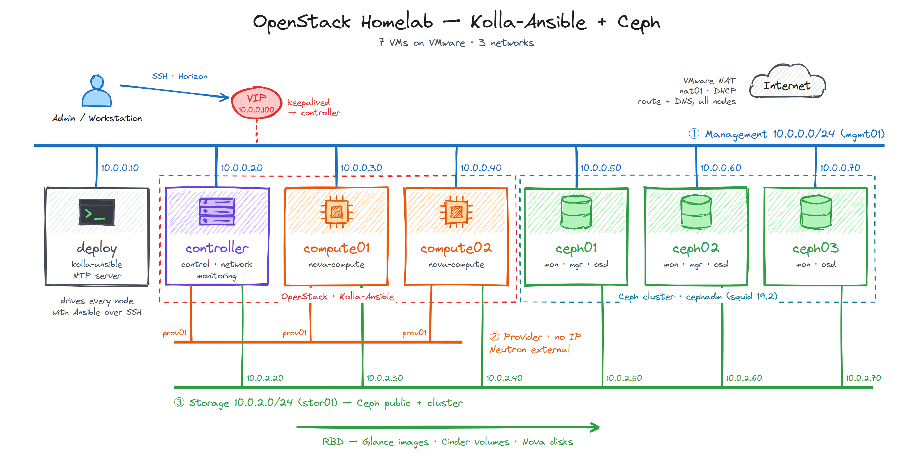

# openstack-homelab

A multi-node **OpenStack 2026.1** cloud deployed with
**[Kolla-Ansible](https://docs.openstack.org/kolla-ansible/latest/)** on 7 VMware
VMs, with a 3-node **Ceph** cluster (cephadm) as the storage backend for images,
volumes and VM disks. Everything needed to rebuild it is in this repo: the
Ansible playbooks that prepare the nodes, per-VM network config, the Ceph
playbooks and the Kolla configuration.



## What's inside

| Component | Version | Notes |
|-----------|---------|-------|
| OpenStack | 2026.1 (Gazpacho) | Keystone, Glance, Nova, Neutron (Open vSwitch), Cinder, Horizon, behind HAProxy + keepalived |
| Kolla-Ansible | 22.x | Upstream images from `quay.io/openstack.kolla`, Docker runtime |
| Ceph | Squid 19.2 | cephadm, 3 MONs, 6 OSDs, 3 replicas; RBD pools `images`, `volumes`, `vms` |
| Ubuntu | 24.04 (OpenStack nodes), 22.04 (deploy VM, Ceph nodes) | |
| Ansible | ansible-core 2.20 (Kolla), 2.16+ (this repo's playbooks) | |

## Hosts

| Host       | Role                               | vCPU | RAM  | Disks              | Management (①) | Storage (③) |
|------------|------------------------------------|------|------|--------------------|----------------|-------------|
| deploy     | Ansible / Kolla-Ansible, NTP server | 4    | 4 GB | 50 GB              | 10.0.0.10      | —           |
| controller | Control plane, Neutron, monitoring | 4    | 8 GB | 50 GB              | 10.0.0.20      | 10.0.2.20   |
| compute01  | Nova compute (KVM)                 | 4    | 8 GB | 50 GB              | 10.0.0.30      | 10.0.2.30   |
| compute02  | Nova compute (KVM)                 | 4    | 8 GB | 50 GB              | 10.0.0.40      | 10.0.2.40   |
| ceph01     | Ceph mon · mgr · osd               | 4    | 8 GB | 50 GB + 2 × 100 GB | 10.0.0.50      | 10.0.2.50   |
| ceph02     | Ceph mon · mgr · osd               | 4    | 8 GB | 50 GB + 2 × 100 GB | 10.0.0.60      | 10.0.2.60   |
| ceph03     | Ceph mon · osd                     | 4    | 8 GB | 50 GB + 2 × 100 GB | 10.0.0.70      | 10.0.2.70   |
| **VIP**    | `kolla_internal_vip_address`       |      |      |                    | **10.0.0.100** | —           |

About 28 vCPU and 52 GB RAM in total. The compute VMs need nested
virtualization (VMware: *Virtualize Intel VT-x/EPT or AMD-V/RVI*), otherwise
`/dev/kvm` is missing and `nova_compute_virt_type: kvm` fails.

## Networks

| # | Name       | CIDR          | NIC      | Purpose |
|---|------------|---------------|----------|---------|
| — | NAT        | DHCP (VMware) | `nat01`  | Internet access, default route + DNS, every VM |
| ① | Management | 10.0.0.0/24   | `mgmt01` | SSH, Ansible, OpenStack APIs, VIP (`network_interface`) |
| ② | Provider   | no IP         | `prov01` | Neutron external network (`neutron_external_interface`), controller + computes |
| ③ | Storage    | 10.0.2.0/24   | `stor01` | Ceph public + cluster traffic, OpenStack → Ceph RBD (`storage_interface`) |

NICs are matched by MAC and renamed by [netplan](netplan/README.md), so the names
are the same on every VM.

## Repository layout

```
.
├── ansible.cfg            # uses inventory/hosts.yml
├── inventory/
│   ├── hosts.yml          # this repo's inventory: VMs by name and role (mgmt_ip / storage_ip)
│   ├── group_vars/        # networks, NIC names, VIP, Ansible user
│   ├── host_vars/
│   └── multinode          # Kolla-Ansible's inventory (2026.1 layout)
├── netplan/               # per-VM network config, matched by MAC
├── playbooks/             # node prep, Ceph build/pools, Kolla config sync, health check, OS upgrade
├── ceph/                  # Ceph build and Day 2 guides (cephadm), manual runbook for reference
├── kolla/                 # globals.yml, Ceph client config, deploy guide, Day 2 operations
└── docs/                  # architecture diagram
```

## Rebuilding the lab

Everything runs from the **deploy VM**, in a clone of this repo
(`~/openstack-homelab`).

### 0. Adapt it to your environment

| What | Where |
|------|-------|
| Ansible user (here `opadm`, same account on every VM) | `inventory/group_vars/all.yml` (`ansible_user`), `inventory/multinode` |
| IP addresses, VIP | `inventory/hosts.yml`, `inventory/group_vars/all.yml`, `inventory/multinode`, `kolla/globals.yml`, `netplan/*.yaml` |
| MAC address of every NIC | `netplan/<host>.yaml` (from each VM's `.vmx`: `ethernet0.address`, `ethernetN.generatedAddress`) |
| Ceph hosts, labels, OSD policy, pools, users | `inventory/hosts.yml` (`ceph_labels`), `inventory/group_vars/ceph_nodes.yml` (every empty disk becomes an OSD) |
| Ceph dashboard password | `-e ceph_dashboard_password=...` on `ceph-cluster.yml` (never committed) |

### 1. Create the VMs

Ubuntu Server on all 7 VMs with the sizes above, the same admin user
everywhere, and 4 NICs (3 on deploy and on the Ceph nodes) in this order: NAT,
management, storage, provider. On the deploy VM:

```bash
sudo apt install -y python3-venv git
python3 -m venv ~/venv && source ~/venv/bin/activate
pip install 'ansible-core>=2.16'          # the playbooks use built-in modules only
git clone <this repo> ~/openstack-homelab && cd ~/openstack-homelab
ssh-keygen -t ed25519 && for h in 10.0.0.{20,30,40,50,60,70}; do ssh-copy-id $h; done
```

### 2. Prepare the nodes

```bash
ansible-playbook playbooks/preconfig.yml -K
ansible all -m ping
```

`preconfig.yml` runs in four tagged parts (`--tags sudo|hosts|netif|ntp`):

| Tag     | What it does |
|---------|--------------|
| `sudo`  | `/etc/sudoers.d/<user>` with `NOPASSWD:ALL` (checked with `visudo`) on every node except the deploy VM. Kolla-Ansible fails with "Missing sudo password" without it. |
| `hosts` | On cloned VMs, regenerates `/etc/machine-id` and the SSH host keys (also `--tags clone`). Sets hostnames and writes every node into `/etc/hosts`; on the deploy VM, trusts host keys by name and adds `~/.ssh/config`, so `ssh controller` works. |
| `netif` | Installs `netplan/<host>.yaml`, renaming NICs by MAC to `nat01` / `mgmt01` / `stor01` / `prov01`. Reboots nodes one at a time; reboot the deploy VM yourself afterwards. |
| `ntp`   | chrony: the deploy VM syncs from the internet and serves `10.0.0.0/24` (`local stratum 10` fallback); every other node follows only the deploy VM, keeping Ceph within its 0.05 s clock-skew limit. Time zone UTC. |

Plays that need root set `become: true` themselves; `-K` asks for the sudo
password (not needed once the `sudo` tag has run).

### 3. Build the Ceph cluster

```bash
ansible-playbook playbooks/ceph-prereqs.yml -K    # upgrade, Docker, cephadm
ansible-playbook playbooks/ceph-cluster.yml -e ceph_dashboard_password='<dashboard-password>'
```

`ceph-cluster.yml` bootstraps ceph01, distributes cephadm's root SSH key
(`ceph-ssh.yml`), applies the hosts, MONs, MGRs and OSDs from the inventory,
then creates the pools and users (`ceph-pools.yml`). Its tags are described in
[ceph/README.md](ceph/README.md).

| `ceph-prereqs.yml` tag | What it does |
|-----------|--------------|
| `upgrade` | `apt update` + `apt upgrade` |
| `docker`  | `docker.io` (cephadm's container runtime), enabled and started |
| `cephadm` | download.ceph.com repo for `ceph_release` (default `squid`; `-e ceph_release=tentacle` or `reef`) + `cephadm` and `ceph-common` |
| `reboot`  | Reboots only nodes with `/var/run/reboot-required`, one at a time |

### 4. Deploy OpenStack

Follow [kolla/README.md](kolla/README.md): kolla-ansible in a Python 3.12
virtualenv, `/etc/kolla` synced from `kolla/` by `playbooks/kolla-config.yml`,
the Ceph keyrings (`ceph-pools.yml --tags clients`), then
`bootstrap-servers` → `prechecks` → `pull` → `deploy` → `post-deploy`.
It also lists the problems met along the way and their fixes.

### 5. Log in

Horizon at `http://10.0.0.100/`: domain `Default`, user `admin`, password
`keystone_admin_password` from `/etc/kolla/passwords.yml`.

## Day 2 operations

Run the health check before and after every change. It changes nothing and
fails if any check fails:

```bash
ansible-playbook playbooks/health.yml
```

| `health.yml` tag | What it checks |
|------------------|----------------|
| `nodes` | Every host: reachable, chrony offset < 0.05 s, ≥ 15% free on `/`, renamed NICs up, management/storage IPs present, pending reboot (warning) |
| `ceph` | On ceph01: HEALTH_OK (warnings listed), MON quorum, OSDs up/in, PGs `active+clean`, fullest OSD < 40%, cephadm daemons running, new crashes (warning) |
| `openstack` | Kolla containers running and healthy on controller and computes; from the deploy VM: Keystone on the VIP, compute services, network agents and volume services up |

[kolla/OPERATIONS.md](kolla/OPERATIONS.md) covers running the cloud:

- adding or removing compute nodes and controllers
- enabling and disabling services, and changing their config
- upgrades, backups and restore
- the power off / power on order

[ceph/OPERATIONS.md](ceph/OPERATIONS.md) does the same for the Ceph cluster:

- node maintenance
- adding and replacing OSDs, adding and removing nodes
- capacity rules and upgrades
- keeping Kolla's `ceph.conf` in step
- backups

## Adding a cloned VM

A clone starts with its parent's netplan, MACs and identity, so it comes up
with no management IP. Example: ceph02/ceph03, cloned from ceph01.

1. **VM powered off, in VMware:** a NAT adapter with a *static* MAC is copied
   as is by cloning. Give the clone its own: *VM Settings → Network Adapter
   (NAT) → Advanced → MAC Address*. The other adapters get new generated MACs.
2. **In the repo:** add the host to `inventory/hosts.yml` and write
   `netplan/<host>.yaml` with the MACs from the VM's `.vmx` file
   (`ethernet0.address`, `ethernet1/2.generatedAddress`).
3. **On the clone's VMware console**, give the management NIC a temporary IP
   (gone at the next reboot):
   ```bash
   sudo ip addr add 10.0.0.60/24 dev ens37 && sudo ip link set ens37 up
   ```
4. **On the deploy VM**, run the whole playbook *without* `--limit` (the clone
   check compares machine-ids across hosts):
   ```bash
   ansible-playbook playbooks/preconfig.yml -K
   ```
   The clone keeps the deploy VM's SSH key from its parent, so Ansible gets in;
   the run then gives it a new identity, its hostname, its own netplan
   (reboot), and time sync.

## Tip: editing from a workstation

The deploy VM's clone can receive pushes directly, so one `git push` updates
both the remote and the deploy VM:

```bash
# on the deploy VM, once
git -C ~/openstack-homelab config receive.denyCurrentBranch updateInstead
# on the workstation, once
git config --add remote.origin.pushurl "$(git remote get-url origin)"
git config --add remote.origin.pushurl <user>@10.0.0.10:openstack-homelab
```

The push is refused while the deploy VM's clone has uncommitted changes:
commit on the workstation, not on the VM.
