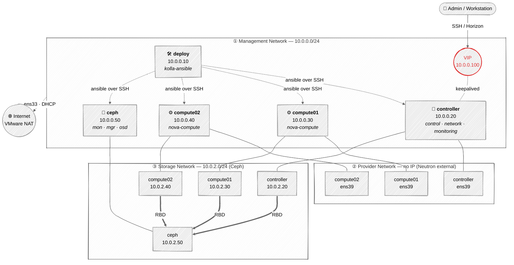

# openstack-homelab

OpenStack homelab deployed with **[Kolla-Ansible](https://docs.openstack.org/kolla-ansible/latest/)**
on 5 VMs, with **Ceph** as the storage backend. This repo holds all configuration
and docs; it is the source of truth for the lab.

## Architecture



## Hosts

| Host       | Role                              | Management (①) | Storage (③) |
|------------|-----------------------------------|----------------|-------------|
| deploy     | Kolla-Ansible deployment node     | 10.0.0.10      | —           |
| controller | Control plane, Neutron, monitoring | 10.0.0.20      | 10.0.2.20   |
| compute01  | Nova compute (hypervisor)         | 10.0.0.30      | 10.0.2.30   |
| compute02  | Nova compute (hypervisor)         | 10.0.0.40      | 10.0.2.40   |
| ceph       | Ceph cluster (Glance/Cinder/Nova) | 10.0.0.50      | 10.0.2.50   |
| **VIP**    | `kolla_internal_vip_address`      | **10.0.0.100** | —           |

## Networks

| # | Name       | CIDR          | Purpose                                                     |
|---|------------|---------------|-------------------------------------------------------------|
| —  | NAT        | DHCP (VMware) | Internet access, default route + DNS (`ens33`)              |
| ① | Management | 10.0.0.0/24   | SSH, Ansible, OpenStack APIs, internal VIP (`network_interface`, `ens37`) |
| ② | Provider   | no IP         | Neutron external network (`neutron_external_interface`) `ens39` on controller/computes |
| ③ | Storage    | 10.0.2.0/24   | Ceph client/public traffic (`storage_interface`, `ens38`)    |

## Repository layout

```
.
├── ansible.cfg          # points at inventory/hosts.yml
├── inventory/
│   ├── hosts.yml        # all VMs, grouped by role
│   ├── group_vars/      # shared vars (networks, interfaces, VIP)
│   └── host_vars/       # per-host overrides
└── netplan/             # per-VM netplan — source of truth for host networking
```

## Quick start

```bash
ansible all -m ping          # from the deploy node, repo root
```

See [netplan/README.md](netplan/README.md) to apply network configs.
